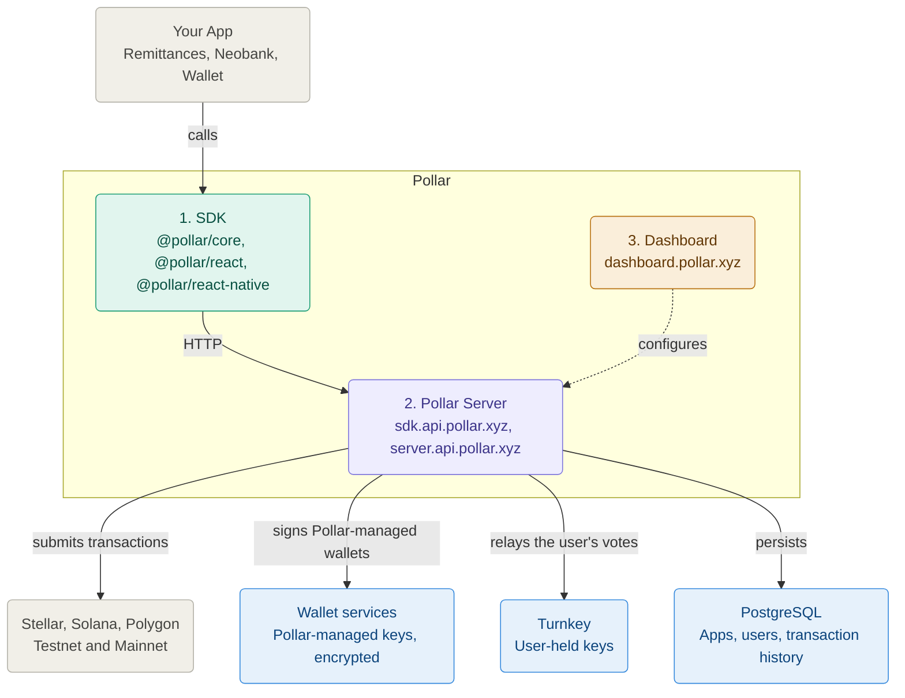
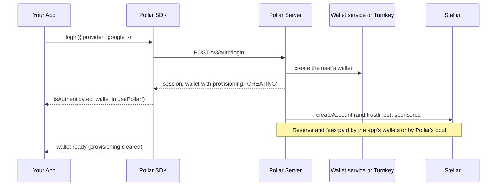

Pollar sits between your app and the chains it serves: Stellar, Solana and Polygon. This page explains how its components interact and how requests flow from your frontend to the blockchain. See [Chain Support](https://docs.pollar.xyz/docs/core-concepts/chain-support) for what each chain supports.

---

## The components

| Component | Runs where | Your responsibility |
| --- | --- | --- |
| **SDK** (`@pollar/core`, `@pollar/react`, `@pollar/react-native`) | Your frontend | Install and configure with your publishable key |
| **Pollar Server** | Hosted by Pollar at `sdk.api.pollar.xyz` (SDK API) and `server.api.pollar.xyz` (Server API) | Nothing: you call it through the SDK or the REST API |
| **Dashboard** | Hosted by Pollar at `dashboard.pollar.xyz` | Configure your app: chains, custody, funding, sponsorship, ramps, billing |

Behind the server, Pollar's wallet services hold the encrypted keys of Pollar-managed wallets, one service per chain and network. Turnkey holds the keys of co-signed and self-custody wallets, which only the user's device can propose a signature for. See [Security Model](https://docs.pollar.xyz/docs/core-concepts/security-model).

---

## Networks

| Network | Notes |
| --- | --- |
| **Testnet** | Development and testing. Stellar testnet, Solana devnet, Polygon Amoy. |
| **Mainnet** | Production. Real assets. A new app starts on testnet; mainnet access is requested from the dashboard and approved by Pollar. |

Futurenet is not supported by default. If your project requires it, [contact us](mailto:hello@pollar.xyz).

Each network has its own API keys: see [API Keys](https://docs.pollar.xyz/docs/getting-started/api-keys) for prefixes and usage rules.

> Full details on Stellar networks at [developers.stellar.org/docs/networks](https://developers.stellar.org/docs/networks).

---

## Who pays for the chain

Running wallets costs XLM reserves, network fees and starting balances. Each app pays them one of two ways, its **billing model**:

| Billing model | Who pays the chain | What the app keeps funded |
| --- | --- | --- |
| **Own wallets** (`LEGACY_WALLETS`) | The app's own operator wallets, which Pollar signs for | XLM, SOL or POL in those wallets |
| **Credits** (`CREDITS`) | Pollar's pool, which charges the app in credits (100 credits = 1 USD) | A credit balance, topped up with USDC or USDT |

On an app on credits, a paid flow answers **402 `SDK_CREDITS_INSUFFICIENT`** (or `SDK_BILLING_OVERDUE` for an overdue postpaid statement) when the credits do not cover it. See [Credits and Billing Models](https://docs.pollar.xyz/docs/core-concepts/credits).

### Operator wallets

An app on its own wallets has Stellar accounts that cover costs on behalf of its users: not user funds, but the infrastructure costs of running wallets.

| Role | Covers | Charged when |
| --- | --- | --- |
| **Funding** | XLM reserve and starting balance for new user wallets | Once per wallet activation |
| **Gas** | Transaction fees (fee-bumps) | Every sponsored transaction |
| **Distribution** | Assets sent through distribution rules | Every claim |

A new app has one wallet, the **global** wallet, that covers all three roles. An app that was split earlier keeps a separate wallet per role. Solana and Polygon each have a GAS wallet of their own, created from the dashboard. On an app on credits, distribution claims pay from the app's distribution vault instead.

For balances and funding see [Account Funding](https://docs.pollar.xyz/docs/operator-guide/wallets/account-funding).

---

## Request lifecycle

What happens from the moment a user calls `login()` to the moment their wallet is ready, on an app that creates wallets at login:

Provisioning runs after the login returns: until the account exists on-chain the wallet reports `provisioning: 'CREATING'` and a send answers `SDK_WALLET_NOT_READY`. On a Turnkey wallet the account creation is a request the user approves. An app can also create wallets on demand (`createWallet()`, `POST /v3/wallet/provision`) or never; see [Wallet Creation](https://docs.pollar.xyz/docs/core-concepts/wallet-creation). For the deferred funding flow see [Funding Modes](https://docs.pollar.xyz/docs/core-concepts/funding-modes).

---

## Data persistence

| Data | Where it lives | Retention |
| --- | --- | --- |
| Transaction history | Pollar PostgreSQL (`tx_records`) | Indefinite |
| Pollar-managed private keys | Wallet service databases, AES-256-GCM encrypted | Per key lifecycle |
| Co-signed and self-custody keys | Turnkey enclaves | Per wallet lifecycle |
| App configuration | Pollar PostgreSQL | Per app lifecycle |

Pollar records every transaction it builds, signs, sponsors or submits for your app, on every chain, and serves history from those records. It does not index the whole blockchain. For details see [Transaction History](https://docs.pollar.xyz/docs/core-concepts/transaction-history).
