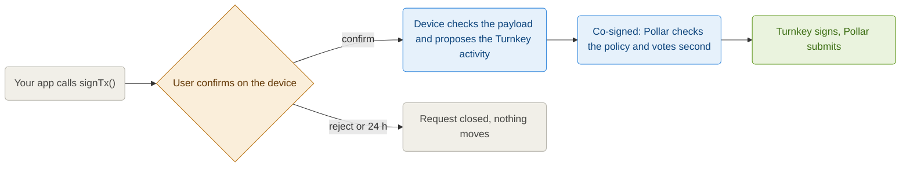

Pollar can create wallets whose key it never holds. The key lives in a [Turnkey](https://www.turnkey.com) secure enclave, inside a sub-organization that belongs to one end user, and the user's device holds the credential that signs. There are two kinds:

| Custody | Root quorum | Who signs | What Pollar can do |
| ------- | ----------- | --------- | ------------------ |
| **Co-signed (2-of-2)** | The user's device and Pollar's approver, threshold 2 | Both: every signature needs the device's proposal and Pollar's vote | Refuse to vote on a transaction that breaks the app's policy. It cannot move funds alone |
| **Self-custody (1-of-1)** | The user's device alone, threshold 1 | The device alone | Relay the signatures and decide which fees to sponsor. It cannot move, freeze or recover the funds |

On **mainnet** every wallet Pollar creates is one of these two: Pollar does not custody end-user funds there, and an app cannot pick Pollar custody on a mainnet app. On **testnet** wallets stay in Pollar custody (see [Security Model](https://docs.pollar.xyz/docs/core-concepts/security-model)) unless Pollar has enabled Turnkey wallets on testnet for that app.

---

## The model

Each end user gets a Turnkey sub-organization:

| Root user | Credential | Who holds it |
| --------- | ---------- | ------------ |
| The end user | A P-256 key the SDK generates on the device (non-extractable WebCrypto on the web, the secure keystore on React Native) | Only the device |
| Pollar's approver (co-signed only) | A P-256 API key per application (a primary and a standby) | Pollar's co-signing service |

The wallet inside the sub-org holds one account per chain the app enables: Stellar, Solana and Polygon addresses derived from the same seed. A chain enabled later is added as a request the user approves.

Pollar records what needs a signature, but no Turnkey activity exists until the user's device proposes it. The device reads the unsigned payload, checks it, builds the exact Turnkey request from the values it checked and relays it through Pollar. On a co-signed wallet Pollar's approver then votes second, and only on an activity that matches the payload Pollar recorded. On a self-custody wallet the device's proposal completes the activity by itself.



A request waits 24 hours for the user; after that it expires and nothing moves.

A transaction built when the request opens would be stale by the time a user gets to it: a Solana blockhash lasts about a minute, a Stellar sequence or a sponsor's signature a few minutes. So the SDK asks Pollar to **rebuild the request right before the vote**. The request keeps its id, and what the device checks and proposes is seconds old. A transaction your app composed itself (an XDR you built and passed to `signTx`) is approved as it is.

---

## Turning it on

**Wallets > Wallet settings > Wallet custody** in the dashboard (see [Wallet settings](https://docs.pollar.xyz/docs/operator-guide/wallets/settings)):

- **Co-signed with Turnkey (2-of-2)**
- **Self-custody with Turnkey (1-of-1)**: a user who loses every recovery method loses the wallet, and Pollar cannot help.

The setting applies to wallets created from then on. A user whose wallets Pollar still custodies in an app that now uses Turnkey moves them from the device (see [Moving custodial wallets to Turnkey](#moving-custodial-wallets-to-turnkey)).

Turnkey wallets need `@pollar/core` **0.12.0 or later**: the device proposes each activity, and the SDK shows the approval prompt. On an app in a Turnkey mode, a login or `createWallet()` from an SDK that cannot send a device key answers **409 `SDK_UPGRADE_REQUIRED`** for users who have no wallet yet.

---

## What the user sees

Every signature asks the user unless the app's dashboard says otherwise. The policy comes from **Wallet settings > Signature confirmation** (always ask, ask once and then sign for a window, or never ask), and the SDK's `confirmation` option can only make it stricter:

```ts
const pollar = new PollarClient({
  apiKey,
  // Unset: follow the dashboard. Set: the stricter of the two applies.
  confirmation: 'prompt', // or 'auto', or { window: { seconds: 300, maxUsd: 50 } }
});

// Headless apps render the prompt themselves; @pollar/react shows ConfirmModal.
pollar.onConfirmationRequest((pending) => {
  for (const c of pending) {
    askTheUser(c) ? c.confirm() : c.reject();
  }
});
```

A window covers payments the SDK can value in USD (`sendPayment`, `buildAndSignAndSubmitTx('payment', ...)`); a raw `signTx`, a swap or a contract call always asks. **A ramp leg always asks**, whatever the policy. A declined prompt ends the call with `SDK_CONFIRMATION_DECLINED`; with a prompt due and nothing subscribed, the call ends with `SDK_CONFIRMATION_UNAVAILABLE` rather than signing unasked.

**Nothing on a Turnkey wallet is approved without the user**, setup included. Creating the Stellar account, adding a trustline and adding the account of a newly enabled chain are requests the user approves like any other. Until the account exists, the wallet reports `provisioning: 'CREATING'`. `recognizedSetupRequest(request)` tells setup apart, for an app that wants to label it.

With `@pollar/react`, the provider opens **`<CosignModal>`** for each request. The modal checks the payload, reads the quorum from Turnkey, and enables **Approve** only when both match; the transaction then continues on its own. A payload that does not match is rejected and the call ends with `SDK_COSIGN_VERIFICATION_FAILED`.

To drive the vote yourself, pass `cosignManual: true`. Signing calls then come back pending and your app approves through `pollar.cosign` from a user action:

```ts
const result = await pollar.signAndSubmitTx({ xdr });

if (result.status === 'cosign_pending') {
  // result.request is the CosignRequest waiting for the user's vote.
  await pollar.cosign.approve(result.request);
}
```

The headless API:

| | What it does |
| - | ------------ |
| `useCosign()` | `pending`, `lastResolved`, `loaded`, `approve`, `reject`, `verify`, `refresh`, `inspectQuorum`, `devices`, `revokeDevice`, `switchCustody` |
| `pollar.cosign.pending()` | The requests waiting for this device |
| `pollar.cosign.verify(request)` | Checks the unsigned payload and returns the `proposal`: the Turnkey request the device would relay. Never trusts the server's summary |
| `pollar.cosign.refresh(request)` | Asks Pollar to rebuild the request with fresh chain state; `approve` does this on its own |
| `pollar.cosign.approve(request)` | Refreshes, verifies and relays the proposal. Throws `SDK_COSIGN_VERIFICATION_FAILED` and sends nothing if the payload does not check out |
| `pollar.cosign.settle(request)` | Reads a proposed request back until Turnkey settles it |
| `pollar.cosign.reject(request)` | Closes the request on the server |
| `pollar.cosign.inspectQuorum()` | Reads the root quorum from Turnkey with the device key (2-of-2 with Pollar's approver, or the user alone at threshold 1, with this device registered) and records the reading with Pollar. The modals run it and refuse to approve on a quorum that is not the promised one |
| `pollar.cosign.switchCustody(to)` | Moves the wallet between co-signed and self-custody, checking each step before the device stamps it. Only an app whose custody mode lets each user choose allows it; otherwise it answers 403 `SDK_COSIGN_CUSTODY_SWITCH_NOT_ALLOWED` |
| `pollar.cosign.devices()` / `revokeDevice(id)` | The device keys enrolled for this user; revoking another device takes this device's own vote |
| `pollar.onCosignStateChange(cb)` | Fires on every pending or resolved request |

The same requests are reachable over HTTP under `/v3/cosign` on the SDK API: `requests`, `requests/:id`, `requests/:id/refresh`, `requests/:id/cancel`, `relay`, `quorum/verify`, `devices`, `devices/enrollments`, `recovery`, `custody/next`, `custody/step` and `custody/migration`.

---

## Recovery

A Turnkey wallet is recovered with a method the user adds directly with Turnkey. Pollar never sets a recovery email or marks a method as verified: the sub-organization is created without an email, and an email the user adds is confirmed with a code sent encrypted to Turnkey's enclave, not through Pollar.

| Method | How |
| ------ | --- |
| Passkey | `pollar.cosign.recovery.addPasskey()`; a device that lost access recovers with `recoverWithPasskey()` |
| Email | `startEmail(email)` then `confirmEmail(code)`; recover with `startEmailRecovery()` then `recoverWithEmailCode(code)` |
| Another device | A new device calls `requestDeviceEnrollment()` and an enrolled device approves it with `approveDevice(id)` or refuses it with `rejectDevice(id)` |

**Until the wallet has a recovery method, it signs only its own setup** (the account creation and trustlines that let it receive). Any other signature answers **409 `SDK_WALLET_RECOVERY_REQUIRED`**, and a ramp leg that would deliver funds to it waits for the user. With `@pollar/react`, `recoveryLocked` is true, the wallet menu shows the lock with a way to fix it, and `<RecoveryModal>` adds a method. A headless app reads the same state from `pollar.cosign.recovery.status()`.

When Turnkey refuses a step (a wrong code, an expired session), the call ends with **502 `SDK_COSIGN_TURNKEY_REJECTED`** carrying Turnkey's own message; `cosignRefusalMessage(error)` gives text to show the user.

The [Passkeys and wallet recovery](https://docs.pollar.xyz/docs/guides/passkeys-guide) guide walks through the screens.

---

## Moving custodial wallets to Turnkey

When an app uses a Turnkey mode, a user whose wallets Pollar still custodies moves them from the device. `pollar.cosign.custodyMigration()` reports what must move, and `migrateWallet(custody, { chain })` or `migrateWallets(custody)` moves it, the device voting the account each wallet moves to. On Stellar the account keeps its address; on Solana and Polygon the funds move to a new Turnkey address, which the user is told about. While something prevents the move the call answers **409 `SDK_CUSTODY_MIGRATION_BLOCKED`** with `body.reasons`.

With `@pollar/react`, `<CustodyMigrationModal>` opens right after login, lists every wallet that moves, warns when an address changes, and lets a blocked user continue later.

---

## Solana and Polygon

A Solana transfer from a Turnkey wallet goes through the same `POST /v3/tx/build-sign-submit` as a custodial one and answers `202` with the request. Pollar compiles the transaction, the device checks the destination, amount and mint before it approves, and refuses a request whose fee could pass the 0.001 SOL cap. When the token is marked **sponsor transfers** in the dashboard, the app's GAS wallet is the fee payer and signs last; otherwise the user pays the fee in SOL.

A Polygon transfer works the same way: `POST /v3/tx/build-sign-submit` with `chain: 'POLYGON'` answers `202` with the request the user votes on. Outcomes land in `/v3/tx/status` and the history as usual.

---

## The device key

The device key is not the DPoP session key: it lives in its own namespace and survives logout, because losing it would mean losing the vote. A user who signs in on a new device asks to join from it, and a device already enrolled approves or refuses the request; without one, the user recovers with a passkey or an email code. Pollar relays these requests but cannot alter them, since the device's stamp covers the body byte for byte.

---

## Export and leaving Pollar

The user alone can export the wallet: `pollar.cosign.recovery.exportWallet()` returns the recovery phrase, decrypted on the device. Pollar is not part of that vote, and the export bundle is encrypted to a key the device provides, so the seed is never visible to Pollar on its way out. If Pollar disappears, the funds do not.

---

## What Pollar still does

Turnkey signs a Stellar transaction as raw bytes and cannot read it, so on a co-signed wallet the checks that protect the app run in Pollar before its vote: the same per-transaction policy every Pollar-signed Stellar transaction passes (the app's fee and operation caps, account merge only to allowed destinations, no signer, master weight or threshold changes). A transaction that fails it gets no vote. The user's device checks what it is asked to sign; the two votes cover different risks.
