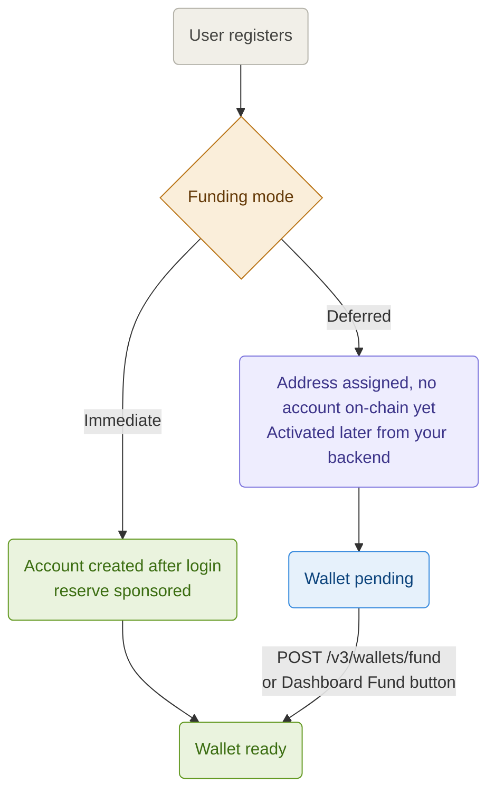

Every Stellar account needs a minimum XLM reserve to exist on-chain. Pollar gives you two modes to control when that reserve is funded, so you only pay for users who matter to your app.

Configure the funding mode from **Dashboard > Wallets > Account Funding** (Stellar tab). No code changes required.

Funding applies once a wallet exists. When the wallet is created (at login, on demand or never) is a separate setting: see [Wallet Creation](https://docs.pollar.xyz/docs/core-concepts/wallet-creation).

---

## The two modes



| Mode | XLM cost | Activation trigger | Best for |
| --- | --- | --- | --- |
| **Immediate** | About 1 to 2 XLM locked per registration | Automatic after login | Apps without compliance requirements |
| **Deferred** | About 1 to 2 XLM locked per funded wallet only | A call from your backend | Neobanks, remittance apps, KYC-gated products |

Deferred funding applies to **Pollar-managed wallets**. A co-signed or self-custody wallet (every new wallet on mainnet) has its account created by a request the user approves, which Pollar opens after login in Immediate mode; `POST /v3/wallets/fund` refuses those wallets, since Pollar cannot sign for them. Use Immediate on an app whose wallets live in Turnkey.

> **How the reserve is covered:** every Stellar account needs a base reserve of **1 XLM**, and each trustline (asset) you configure in the dashboard adds **0.5 XLM**. Pollar sponsors these reserves (CAP-33): the XLM stays **locked in the sponsor's account** while it sponsors the user wallet; it is not transferred to the user. The sponsor is your app's funding wallet, or Pollar's pool on an [app on credits](https://docs.pollar.xyz/docs/core-concepts/credits), which charges the reserve in credits.
>
> `1 XLM + (number of configured assets x 0.5 XLM)` locked per funded wallet
>
> | Assets configured | Reserve required |
> | --- | --- |
> | 0 | 1 XLM |
> | 1 (e.g. USDC) | 1.5 XLM |
> | 2 (e.g. USDC + EURC) | 2 XLM |
> | 3 | 2.5 XLM |
>
> On top of the locked reserve, the **starting balance** configured in **Dashboard > Wallets > Account Funding** (if any) is transferred to each new wallet as spendable XLM. Solana and Polygon have their own starting balances (SOL and POL) on the same page.
>
> References: [Minimum Balance](https://developers.stellar.org/docs/learn/fundamentals/lumens#minimum-balance), [Trustlines](https://developers.stellar.org/docs/learn/fundamentals/stellar-data-structures/accounts#trustlines)

---

## Immediate

Pollar creates the account after the user logs in. The login returns right away with the wallet in `provisioning: 'CREATING'`; once the account lands on-chain (a few seconds) the SDK clears it. Until then a send answers `SDK_WALLET_NOT_READY`. On a co-signed or self-custody wallet the account creation is a request the user approves first.

**Cost:** the sponsored reserve is locked for every registration, including users who abandon onboarding, plus the configured starting balance, if any.

```tsx
const { login, wallet } = usePollar();
await login({ provider: 'google' });
// wallet.provisioning === 'CREATING' until the account exists on-chain
```

---

## Deferred

The user gets a Stellar address at registration, but Pollar does not create the account on-chain. The wallet cannot transact until it is activated.

**Cost:** the reserve is only locked for users you fund. Zero cost for users who abandon.

This mode solves a problem specific to Stellar: every account needs a minimum XLM reserve to exist on-chain. Without deferred funding, an app with 10,000 users who abandon onboarding locks 10,000+ XLM for nothing.

### Funding from your backend

Your backend calls `POST /v3/wallets/fund` when a business event occurs: KYC approved, first deposit, email verified, or any trigger you define.

```bash
POST https://server.api.pollar.xyz/v3/wallets/fund
x-pollar-api-key: sec_testnet_xxxxxxxxxxxxxxxxxxxx
Content-Type: application/json

{
  "publicKey": "GXXXXXXXXXXXXXXXXXXXXXXXXXXXXXXXXXXXXXXXXXXXXXXXXXXXXXXX"
}
```

> Never call this endpoint from the client. It requires your secret key and must run on your backend. See the [Server API](https://docs.pollar.xyz/docs/sdk-reference/server-api) reference for every response code.

The answers you plan for:

| Answer | Meaning |
| --- | --- |
| `200 OK` | Wallet funded. Reserve sponsored on-chain. |
| `409 WALLET_ALREADY_FUNDED` | The account already exists. Safe to treat as success. |
| `402 SDK_CREDITS_INSUFFICIENT` / `SDK_BILLING_OVERDUE` | An app on credits whose credits do not cover the reserve, or whose postpaid statement is overdue. |
| `502 FUND_XLM_FAILED` | The sponsor could not fund the account, typically a funding wallet short of XLM. |

### Funding manually from the Dashboard

A not-yet-funded Pollar-managed wallet can be funded from **Dashboard > Wallets > Wallets** with the **Fund** action: the same sponsored funding as login. This works in both modes and is useful for support workflows or one-off overrides.

### Checking whether a wallet is funded

The funded state is on-chain. From an authenticated session, read the wallet's balances: an unfunded wallet has no XLM reserve yet.

```tsx
const { walletBalance, refreshWalletBalance } = usePollar();

await refreshWalletBalance();
if (walletBalance.step === 'loaded') {
  // inspect walletBalance.data.balances to see if the reserve / assets are present
}
```

---

## Switching modes

You can switch funding modes at any time from the dashboard without changing any code. The new mode applies to wallets created after the switch. Existing wallets are not affected.

---

## Cost comparison

For an app with 10,000 registered users where 30% complete activation:

| Mode | XLM locked | Cost basis |
| --- | --- | --- |
| Immediate | About 20,000 XLM | Every registration |
| Deferred | About 6,000 XLM | Only activated users |
| **Savings** | **About 14,000 XLM** | |
