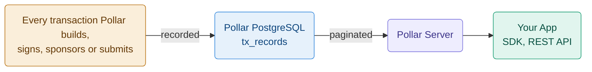

Pollar keeps the transaction history of every wallet in its own database. It does not read history from the chain at request time and does not index the whole blockchain.

---

## Where history comes from



Pollar records a transaction when it handles it, on every chain: Stellar fee-bumps and sponsored operations, Solana and Polygon transfers and co-signed requests. A background reconcile then follows each record until the chain settles it. Transaction records are kept for at least 5 years, the period anti-money-laundering rules require for transaction records.

A transaction an external wallet submits on its own, without going through Pollar, does not appear in the history.

A ramp order is not a transaction record: it is an order with its own legs, which can run on several chains and move funds the user receives rather than sends. The history includes the user's ramp orders when you ask for them with `includeRamps`, each as one row. See [Ramp orders in the history](#ramp-orders-in-the-history).

---

## SDK: React hook

`txHistory` is a reactive state machine (`TxHistoryState`). Trigger a load with `fetchTxHistory()` on the underlying client; the provider keeps `txHistory` in sync. `fetchTxHistory()` includes the user's ramp orders unless you pass `includeRamps: 'false'`.

```tsx
'use client';
import { useEffect } from 'react';
import { usePollar } from '@pollar/react';

export function TxHistory() {
  const { txHistory, getClient } = usePollar();

  useEffect(() => {
    getClient().fetchTxHistory({ limit: 20, offset: 0 });
  }, [getClient]);

  if (txHistory.step !== 'loaded') return <p>Loading...</p>;

  return (
    <ul>
      {txHistory.data.records.map((tx) => (
        <li key={tx.id}>
          {tx.summary} · {tx.status} · {new Date(tx.createdAt).toLocaleDateString()}
        </li>
      ))}
    </ul>
  );
}
```

> The simplest path is the built-in modal: call `openTxHistoryModal()` from `usePollar()`. It lists ramp orders next to the transactions, with the fiat amount of each order.

## SDK: Core client

```typescript
await pollar.fetchTxHistory({ limit: 20, offset: 0 });

const state = pollar.getTxHistoryState();
if (state.step === 'loaded') {
  console.log(state.data.records, state.data.total);
}
```

`fetchTxHistory` drives `TxHistoryState` (it does not return the records directly). Subscribe with `onTxHistoryStateChange` for updates.

---

## REST API

The end-user transaction history is served by the SDK API (publishable key + authenticated end-user session), not by the secret-key Server API:

```bash
GET https://sdk.api.pollar.xyz/v3/tx/history?limit=20&offset=0
```

> There is currently **no secret-key Server API endpoint** for wallet transaction history. Use the SDK (`fetchTxHistory`) from an authenticated session.

**Query parameters:**

| Parameter | Type     | Default | Description                          |
| --------- | -------- | ------- | ------------------------------------ |
| `limit`   | `number` | `20`    | Records per page, 1 to 50.           |
| `offset`  | `number` | `0`     | Offset for pagination.               |
| `chain`   | `'STELLAR' \| 'SOLANA' \| 'POLYGON'` | all | Only this chain's records. A ramp order is included when any of its legs runs on this chain. |
| `includeRamps` | `'true' \| 'false'` | `'false'` | `'true'` adds the user's ramp orders to the list. The SDK sends `'true'` unless you pass `'false'`. |

The environment is the one of the API key; there is no `network` parameter. A `limit` outside 1 to 50 answers `400 VALIDATION_ERROR`.

**Response (`content`):**

```json
{
  "records": [
    {
      "id": "tx_abc123",
      "chain": "STELLAR",
      "hash": "a1b2c3d4...",
      "network": "testnet",
      "status": "SUCCESS",
      "operation": "payment",
      "fee": { "amount": "0.00001", "unit": "XLM" },
      "details": {},
      "summary": "Sent 10.00 USDC",
      "createdAt": "2026-03-15T10:30:00Z",
      "kind": "tx"
    },
    {
      "id": "tx_def456",
      "chain": "SOLANA",
      "hash": "5UfD...",
      "network": "testnet",
      "status": "SUCCESS",
      "operation": "transfer",
      "fee": { "amount": "5000", "unit": "lamports" },
      "details": {},
      "summary": "Sent 10.00 USDC",
      "createdAt": "2026-03-15T10:31:00Z",
      "kind": "tx"
    }
  ],
  "total": 42,
  "limit": 20,
  "offset": 0
}
```

---

## Ramp orders in the history

With `includeRamps=true`, each of the user's ramp orders is one row with `kind: "ramp"`, in the same newest-first list as the transactions. The orders count in `total` and page together with the transactions, so `limit`, `offset` and `total` work the same way.

```json
{
  "kind": "ramp",
  "id": "cmw1q2r3s0000ab12cd34ef56",
  "chain": "SOLANA",
  "hash": "4Nd1mBQt...",
  "network": "mainnet",
  "status": "SUCCESS",
  "operation": "onramp",
  "details": {
    "orderId": "cmw1q2r3s0000ab12cd34ef56",
    "direction": "ONRAMP",
    "state": "completed",
    "fiatAmount": "70",
    "fiatCurrency": "BOB",
    "cryptoAmount": "9.98",
    "assetCode": "USDC",
    "legs": [
      { "index": 0, "kind": "PROVIDER_ONRAMP", "status": "COMPLETED", "chainIn": null, "chainOut": "POLYGON", "hash": "0x9f2c..." },
      { "index": 1, "kind": "BRIDGE", "status": "COMPLETED", "chainIn": "POLYGON", "chainOut": "SOLANA", "hash": "4Nd1mBQt..." }
    ]
  },
  "summary": "Buy 9.98 USDC",
  "createdAt": "2026-11-10T12:00:00Z"
}
```

| Field | On a ramp row |
| ----- | ------------- |
| `id` | The order id, the same one `getRampOrder` takes. |
| `operation` | `onramp` or `offramp`. |
| `chain` | Where the user ends up holding the asset on an on-ramp, or where the asset leaves from on an off-ramp. |
| `hash` | The last on-chain hash of the order, or `""` while it has none. Each leg's hash is in `details.legs`. |
| `details` | The fiat and crypto amounts, as decimal strings, and the order's legs. Amounts are the actual ones once a leg has settled, the quoted ones before. |
| `fee` | Not present on a ramp row. |

The order's state maps to the history status:

| Order state | `status` |
| ----------- | -------- |
| `created`, `awaiting_payment`, `processing`, `settling_onchain` | `PENDING` |
| `completed` | `SUCCESS` |
| `failed` | `FAILED` |
| `refunded` | `FAILED`, with `resultCode: "refunded"` |

The row is a summary. To follow an order step by step, or to act on one waiting for the user, read it with `getRampOrder` or `listRampOrders`.

---

## Pagination

History uses **offset-based** pagination. Increase `offset` by `limit` to page forward; `total` tells you when to stop.

```typescript
async function getAllTransactions() {
  const all = [];
  let offset = 0;
  const limit = 50;

  for (;;) {
    await pollar.fetchTxHistory({ limit, offset });
    const state = pollar.getTxHistoryState();
    if (state.step !== 'loaded') break;
    all.push(...state.data.records);
    offset += limit;
    if (offset >= state.data.total) break;
  }

  return all;
}
```

---

## Transaction status

Each record carries a `status` reflecting its lifecycle:

| Status    | Description                                  |
| --------- | -------------------------------------------- |
| `PENDING` | Built/submitted, not yet confirmed on-chain. |
| `SUCCESS` | Confirmed on-chain.                          |
| `FAILED`  | Rejected by the chain, or failed before submission. |

The human-readable `operation` and `summary` fields describe what the transaction did.

---

## Record type

```typescript
type TxHistoryRecord = {
  kind: 'tx' | 'ramp'; // 'ramp' only with includeRamps
  id: string; // the order id on a ramp row
  chain: 'STELLAR' | 'POLYGON' | 'SOLANA';
  hash: string;
  network: 'testnet' | 'mainnet';
  status: 'PENDING' | 'SUCCESS' | 'FAILED';
  operation: string;
  fee?: { amount: string; unit: string }; // XLM on Stellar, lamports on Solana, wei on Polygon
  resultCode?: string;
  details: Record<string, unknown>;
  summary: string;
  createdAt: string; // ISO 8601
};
```
