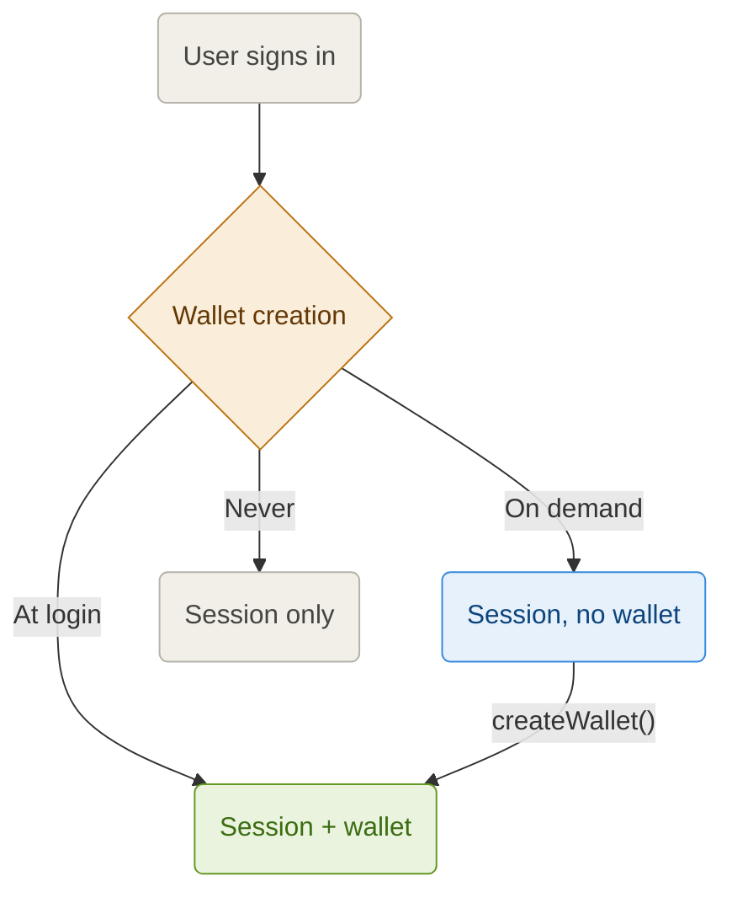

By default every user gets a wallet the first time they sign in. **Wallet creation** decides *when* that wallet exists; [Funding Modes](https://docs.pollar.xyz/docs/core-concepts/funding-modes) decide when it is funded once it does.

Configure it from **Dashboard → Wallets → Wallet settings**. No code changes are needed to keep the default.

---

## The three modes

| Mode | What the login does | Creating the wallet later | Best for |
| ---- | ------------------- | ------------------------- | -------- |
| **At login** (default) | Creates the wallet | Not needed | Apps where every user transacts |
| **On demand** | Signs the user in, no wallet | `createWallet()` in the SDK | Apps where only some users ever need a wallet |
| **Never** | Signs the user in, no wallet | Refused | Authentication only |



The mode applies to wallets that do not exist yet. A user who already has a wallet keeps it in every mode, and each login keeps it funded and its trustlines in place.

---

## A session without a wallet

The user is signed in like any other: the session, tokens and profile are the same. What changes is the wallet:

| | Value |
| - | ----- |
| `wallet.address` | `null` |
| `wallet.provisioning` | `'NONE'` |
| `wallets` | `[]` |
| `pollar.hasWallet()` | `false` |
| `isAuthenticated` (React) | `true` |

Features that need a wallet refuse with **409 `SDK_WALLET_REQUIRED`**: building, signing and submitting transactions, creating an on-ramp or off-ramp, claiming a distribution and funding a card. Balances and enabled assets answer normally, with `error: 'no_wallet'` for each chain the user has no wallet on.

```typescript
import { isWalletRequired } from '@pollar/core';

const result = await pollar.runTx('payment', { destination, amount, asset });
if (isWalletRequired(result)) {
  await pollar.createWallet();
}
```

---

## Creating the wallet on demand

```typescript
if (!pollar.hasWallet()) {
  const wallet = await pollar.createWallet();
  console.log(wallet.address);
}
```

`createWallet()` calls `POST /v3/wallet/provision`. It creates the wallet on every chain your app serves, funds it per your [funding mode](https://docs.pollar.xyz/docs/core-concepts/funding-modes) and sets up your enabled trustlines, exactly as a login does in **At login** mode. It updates the session, so `usePollar()`, `getWallet()` and `onWalletStateChange` all see the new wallet. Calling it again returns the same wallet.

In React, `<WalletButton>` offers **Create wallet** to a signed-in user without one, and `usePollar()` exposes `hasWallet` and `createWallet`.

### Who cannot get one

- **Never** mode: `createWallet()` fails with **403 `SDK_WALLET_PROVISIONING_DISABLED`**.
- Users who signed in with their own wallet (Freighter, Albedo, a Solana wallet, etc.) or a passkey already hold their wallet: **409 `SDK_WALLET_PROVISIONING_UNSUPPORTED`**.

---

## Requirements

On demand and Never need `@pollar/core`, `@pollar/react` or `@pollar/react-native` **0.11.4 or later** in your frontend. Older versions read a session without a wallet as signed out and have no `createWallet()`. Switch the mode after your app ships the new SDK.
