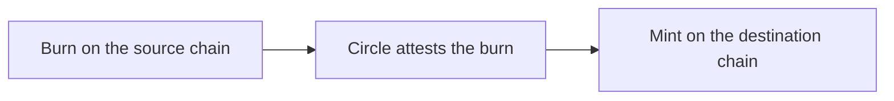

This guide shows how to let your users move their USDC between their own wallets on Stellar, Solana and Polygon. It has two parts:

- **[Part 1: React with the pre-built modal](#part-1-react-with-the-pre-built-modal)**: one function call opens the whole flow.
- **[Part 2: Headless with `@pollar/core`](#part-2-headless-with-pollarcore)**: build your own UI with the client methods.

The modal in Part 1 is built on the methods in Part 2.

---

## How it works

The USDC moves through Circle's Cross-Chain Transfer Protocol (CCTP), in its Standard Transfer: the USDC is burned on the source chain, Circle attests the burn, and the same amount is minted on the destination. It is native USDC on both sides; nothing is wrapped. Circle charges nothing for a Standard Transfer, so the user receives exactly what was burned.

1. **Burn.** The user's wallet on the source chain burns the USDC. A Pollar-managed wallet does it at once; a co-signed wallet approves it on the device; an external wallet signs it in the wallet.
2. **Attestation.** Circle confirms the burn. This is most of the wait: a few minutes.
3. **Mint.** Your app's network fee wallet on the destination chain sends the mint, and the USDC lands in the user's wallet there.



Every direction between the three chains is direct:

| From \ To | Stellar | Solana | Polygon |
|---|:---:|:---:|:---:|
| **Stellar** | - | Yes | Yes |
| **Solana** | Yes | - | Yes |
| **Polygon** | Yes | Yes | - |

The whole move takes about five minutes.

---

## Before you start

1. **Live.** Circle's contracts are on mainnet; on a Test mode app the bridge is off (`getBridgeConfig()` answers `available: false`, `reason: 'mainnet_only'`) and the modal says so.
2. **Enable both chains** in **Wallets > Wallet settings > Enabled chains**. The user needs a wallet on each side of a move.
3. **Network fees.** Your app's network fee wallets pay the burn's fee on Stellar and Solana and the mint on every chain; on Polygon the user's wallet is topped up with the POL its burn needs. On an app on [credits](https://docs.pollar.xyz/docs/core-concepts/credits), Pollar's pool pays and charges the app.
4. **A Stellar destination trusts USDC.** A move to Stellar is refused before anything happens when the user's Stellar wallet has no USDC trustline. Enable USDC in [Tokens & Trustlines](https://docs.pollar.xyz/docs/operator-guide/wallets/tokens-trustlines) so the wallet trusts it first.
5. **Pollar's fee.** Each completed move is charged to the app in credits as `bridge.transfer`, a percentage of the amount with a minimum and a maximum. The quote shows it.

---

## Part 1: React with the pre-built modal

```tsx
import { usePollar } from '@pollar/react';

function MoveUsdcButton() {
  const { openBridgeModal } = usePollar();
  return <button onClick={() => openBridgeModal()}>Move USDC</button>;
}
```

`<BridgeModal>` offers the directions the user holds wallets for, shows the USDC available on the source chain, quotes what arrives and Pollar's fee, and follows the move step by step (leaves the source, confirmed by Circle, arrives on the destination) with a link to each transaction in its explorer. An external wallet's step shows **Authorize**, and the connected wallet (Freighter, Albedo, Stellar Wallets Kit, Phantom, Solflare, Backpack) signs it there; a co-signed wallet's shows **Approve on your device**. The user can close the modal: the move goes on.

Open it on a direction and an amount, which the user can still change:

```tsx
openBridgeModal({
  fromChain: 'POLYGON',
  toChain: 'STELLAR',
  amount: '25',
  onSuccess: (transfer) => track(transfer.id),
});
```

A direction the user cannot move in falls back to the first one offered, and `onSuccess` is called once, when the USDC arrives. React Native has the same modal and options. See [`<BridgeModal>`](https://docs.pollar.xyz/docs/sdk-reference/pollar-react).

---

## Part 2: Headless with `@pollar/core`

### Pick a direction and quote it

```ts
const config = await pollar.getBridgeConfig();
if (!config.available) return; // testnet, or no pair of wallets to move between

const from = bridgeSourceChains(config)[0]; // 'STELLAR' | 'SOLANA' | 'POLYGON'
const to = bridgeTargetChains(config, from)[0];

const quote = await pollar.quoteBridge({ fromChain: from, toChain: to, amount: '25' });
// quote.amountOut, quote.fee (USD, charged to the app; null when the app is not charged),
// quote.etaSeconds, and quote.signing: 'INTERNAL' | 'COSIGNED' | 'SELF_CUSTODY' | 'EXTERNAL'
```

`bridgeSourceChains` and `bridgeTargetChains` are exported from `@pollar/core`. Amounts are USDC with up to 6 decimals.

### Start it

```ts
const transfer = await pollar.bridge({
  fromChain: from,
  toChain: to,
  amount: '25',
  idempotencyKey: crypto.randomUUID(), // one per move the user means to make
});
```

A retry with the same `idempotencyKey` (a double click, a response that never arrived) returns the transfer it already started and moves nothing.

### Sign or approve, when it asks

What happens next depends on the source wallet:

- **Pollar-managed:** the burn is sent at once.
- **Co-signed or self-custody:** `transfer.pendingAction` is `COSIGN_APPROVAL`. The user approves the request on the device, through `<CosignModal>` or your own co-sign UI.
- **External:** `transfer.pendingAction` is `SIGNATURE`. Register a signer for its chain and encoding, as for a ramp leg, and call `signBridgeStep` from the user's explicit **Authorize**:

```ts
const release = pollar.registerRampSigningHandler('STELLAR', 'xdr', async (action) => {
  const signed = await pollar.signTx(action.payload.value);
  if (signed.status !== 'signed') throw new Error('Not signed');
  return signed.signedXdr;
});
const next = await pollar.signBridgeStep(transfer.id, transfer.pendingAction.actionId);
release();
```

A Stellar source signs two steps, an approve and then the burn; a Polygon source signs an approve first only when its USDC allowance does not cover the amount; a Solana source signs one. A Solana burn comes as `SOLANA` / `solana-cctp-json`: its `payload.value` is JSON with `from` and `unsignedTransaction` (base64), which the wallet signs as is and the handler returns (`pollar.signSolanaTransaction(unsignedTransaction)` does it with the connected wallet). Pollar then adds its fee payer's signature and sends it. A Solana burn must be signed within about a minute; a lapsed one is built again and asks again.

### Follow it

```ts
const done = await pollar.pollBridgeTransfer(transfer.id, {
  onUpdate: (t) => render(t.status),
});
```

`pollBridgeTransfer` reads until the transfer settles or waits on the user. The statuses:

| Status | Meaning |
|---|---|
| `PENDING` | The burn is being sent |
| `AWAITING_ACTION` | The user signs or approves (`pendingAction`) |
| `BURNED` | Burned; Circle is attesting it |
| `ATTESTED` | Attested; the mint is being sent |
| `COMPLETED` | The USDC is in the destination wallet (`amountOut`, `mintTxHash`) |
| `FAILED` | Nothing left the user's wallet; start again |
| `HELD` | The USDC was burned and what followed failed. Pollar is alerted and resolves it; nothing is lost |

`burnTxHash` and `mintTxHash` are the two transactions. `listBridgeTransfers()` lists the user's latest moves.

---

## Errors

Bridge calls throw a `PollarApiError`:

| Code | When |
|---|---|
| `SDK_BRIDGE_UNAVAILABLE` | `reason` is `mainnet_only`, `chain_not_enabled`, or `no_gas_wallet` (the app has no network fee wallet on a chain the move uses) |
| `SDK_BRIDGE_ROUTE_UNSUPPORTED` | Not USDC between two different chains of Stellar, Solana and Polygon |
| `SDK_BRIDGE_WALLET_NOT_READY` | `reason` is `no_wallet` (with `chain`), `no_usdc_trustline` (a Stellar destination) or `unsupported_wallet` |
| `SDK_CREDITS_INSUFFICIENT` | The app's credits do not cover Pollar's fee |
| `SDK_BRIDGE_ACTION_CHANGED` | The step to sign changed since it was read: read the transfer again and sign the new one |
| `SDK_BRIDGE_TRANSFER_NOT_FOUND` | No such transfer for this user |

---

## Related

- [`@pollar/core` Bridge](https://docs.pollar.xyz/docs/sdk-reference/pollar-core)
- [USDC bridges](https://docs.pollar.xyz/docs/operator-guide/treasury/bridge) in the dashboard, and the [Server API](https://docs.pollar.xyz/docs/sdk-reference/server-api) `/v3/bridge` for your backend
- [Chain Support](https://docs.pollar.xyz/docs/core-concepts/chain-support)
- [Credits](https://docs.pollar.xyz/docs/core-concepts/credits)
- [Ramps](https://docs.pollar.xyz/docs/core-concepts/ramps), which use the same CCTP bridge as one of their legs
