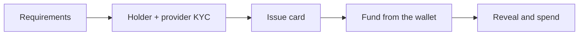

This guide shows how to give your users a virtual card funded from their Pollar wallet. It has two parts:

- **[Part 1: React with the pre-built modal](#part-1-react-with-the-pre-built-modal)**: one function call opens the whole card flow.
- **[Part 2: Headless with `@pollar/core`](#part-2-headless-with-pollarcore)**: build your own UI with the client methods.

The modal in Part 1 is built on the methods in Part 2.

---

## How cards work

A card provider issues the card and holds its collateral. Pollar connects your user to it: the sign-up, the identity checks, issuing the card, funding it from the user's wallet and showing its activity.

1. **Requirements.** The steps the provider needs before it accepts the user: Pollar's KYC, forms, a registry check, and the registration with the provider. They run the same way as for [ramps](https://docs.pollar.xyz/docs/core-concepts/kyc-flow).
2. **Holder and provider KYC.** The user becomes a card holder with the provider and passes its own identity check. The provider answers with a verification link while it reviews.
3. **Issue.** With an approved KYC, the user gets a virtual card.
4. **Fund.** USDC moves from the user's wallet to the card's collateral, and the provider turns it into spending power.
5. **Use.** The card number and CVC are decrypted on the user's device only when the user reveals them. Balance and movements come from the provider.



Steps 1 to 3 and 5 do not depend on the chain. Funding does.

---

## Before you start

1. **Enable a card provider** in **Dashboard > Cards > Providers** ([Providers](https://docs.pollar.xyz/docs/operator-guide/cards/providers)). Cards are off until one is enabled: `getCardProviders()` returns an empty list and the modal shows nothing to start.
2. **Enable the chain your users fund from** in **Wallets > Wallet settings > Enabled chains**: Stellar, Solana or both.
3. **Mainnet.** The card provider available today works on mainnet only.
4. **Who pays the network fee.** On an app on [credits](https://docs.pollar.xyz/docs/core-concepts/credits), Pollar's pool pays it and charges the app. On Solana, the first funding to a card also creates the provider's USDC account, and its rent (about 0.002 SOL) is charged once the same way. Turn this off per token in [Sponsorship](https://docs.pollar.xyz/docs/operator-guide/wallets/sponsorship), and the user pays from their own SOL or XLM.

---

## Funding: Stellar or Solana

| | From Stellar | From Solana |
|---|---|---|
| How the USDC moves | The user pays Pollar's bridge, which moves it to the provider over Circle's CCTP | Straight to the provider's Solana address, one transfer |
| States | `CREATED` -> `BURNED` -> `ATTESTED` -> `MINTED` -> `CREDITED` | `CREATED` -> `SENT` -> `CREDITED` |
| Time to `CREDITED` | One to two minutes, plus the provider's credit | Seconds, plus the provider's credit |
| Pollar-managed wallet | Paid at once | Paid at once |
| Co-signed wallet | The user approves on the device | The user approves on the device |
| External wallet | The connected wallet signs (Freighter, Albedo, Stellar Wallets Kit) | The connected wallet signs (Phantom, Solflare, Backpack) |

`FAILED` carries `error` on either chain. A funding the user never signs fails after 24 hours. The minimum is 1 USDC.

A funding from Stellar is refused with `SDK_CARDS_FUNDING_UNAVAILABLE` (`reason: bridge_low_gas`) while Pollar's bridge cannot pay its own gas; it is a temporary state Pollar is alerted about.

---

## Part 1: React with the pre-built modal

```tsx
import { usePollar } from '@pollar/react';

function CardButton() {
  const { openCardModal } = usePollar();
  return <button onClick={() => openCardModal()}>My card</button>;
}
```

`<CardModal>` walks the user through every step above. Under **Add funds**:

- When the user holds a wallet on both Stellar and Solana, a **Network** picker chooses where the USDC comes from, and the available balance is the one on that chain.
- Each funding shows its own steps ("Step 1 of 2" on Solana, "Step 1 of 4" on Stellar) until it is credited. The user can close the modal; the funding goes on.
- **Prefer to send from another wallet?** shows the provider's deposit address for each network, for a transfer from an exchange or any other wallet.

The modal is translated to English, Spanish and Portuguese with the rest of the SDK. See [`<CardModal>`](https://docs.pollar.xyz/docs/sdk-reference/pollar-react).

---

## Part 2: Headless with `@pollar/core`

### Get the user to an issued card

```ts
const [provider] = await pollar.getCardProviders();
if (!provider) return; // Cards is off for this app

const requirements = await pollar.getCardRequirements();
// While requirements.next is set, run that step: KYC, form, registry check or registration.

let holder = (await pollar.getCardHolder()) ?? (await pollar.createCardHolder());
if (holder.kycStatus === 'NOT_STARTED') {
  holder = await pollar.submitCardKyc({ termsAccepted: true, kyc: form });
}
// Send the user to holder.verificationLink and poll getCardHolder() until kycStatus is 'APPROVED'.

const card = (await pollar.getCards())[0] ?? (await pollar.issueCard({ nickname: 'Travel' }));
```

### Fund the card

`fundCard` takes the amount and, optionally, the chain. Without `chain` it funds from Stellar.

```ts
const outcome = await pollar.fundCard({ amount: '25', chain: 'SOLANA' });

switch (outcome.status) {
  case 'ok':
    // outcome.funding moves on by itself; follow it with getCardFunding
    break;
  case 'cancelled':
    // the user declined: the external wallet did not sign, or the co-sign request was rejected
    break;
  case 'cosign_pending':
    // only with `cosignManual: true`: your app votes outcome.request through pollar.cosign
    break;
}
```

What `fundCard` does depends on the wallet:

- **Pollar-managed:** Pollar pays from the wallet and returns the funding.
- **Co-signed:** the device votes on the payment and the call returns once it is sent.
- **External:** the connected wallet is asked to sign the payment, and the SDK submits it.

Then follow the funding until the provider credits it:

```ts
let funding = outcome.funding;
while (!['CREDITED', 'FAILED'].includes(funding.status)) {
  await new Promise((r) => setTimeout(r, 5000));
  funding = await pollar.getCardFunding(funding.id);
}
const balance = await pollar.getCardBalance();
```

`CardFunding.chain` is the chain it is paid from, and `sourceTxHash` the user's transfer on Solana. On Stellar, `stellarTxHash`, `burnTxHash` and `polygonMintTxHash` are the legs.

### Reveal the card details

```ts
const { pan, cvc, expMonth, expYear } = await pollar.revealCardSecrets(card.id);
// Show them and drop them. Never store or log the result.
```

The provider encrypts the number with a one-shot key generated on the device; Pollar's servers never see it in clear.

---

## Errors

Card calls throw a `PollarApiError`:

| Code | When |
|---|---|
| `SDK_CARDS_REQUIREMENT_REQUIRED` | A platform step is still open. The body names `requirementType` and `optionId` |
| `SDK_CARDS_KYC_NOT_APPROVED` | Issuing or funding before the provider approved the user |
| `SDK_CARDS_FUNDING_WALLET_NOT_READY` | The wallet cannot pay: `reason` is `insufficient_usdc`, `no_usdc_trustline` (Stellar), `balance_unavailable` (Solana), `payment_rejected` or `build_failed` |
| `SDK_CARDS_FUNDING_UNAVAILABLE` | Funding cannot start now: `reason` is `bridge_not_available`, `bridge_low_gas`, `solana_not_available`, `no_solana_usdc_deposit_address`, `no_polygon_usdc_deposit_address` or `wallet_not_supported` |
| `SDK_WALLET_REQUIRED` | The user has no wallet on the chain asked for |
| `SDK_CARDS_PROVIDER_USER_TAKEN` | The email is already registered with the provider through another app |
| `SDK_CARDS_PROVIDER_ERROR` | The provider did not answer |

---

## Related

- [Providers](https://docs.pollar.xyz/docs/operator-guide/cards/providers) and [Card holders](https://docs.pollar.xyz/docs/operator-guide/cards/card-holders) in the dashboard
- [`@pollar/core` Cards](https://docs.pollar.xyz/docs/sdk-reference/pollar-core)
- [Chain Support](https://docs.pollar.xyz/docs/core-concepts/chain-support)
- [KYC flow](https://docs.pollar.xyz/docs/core-concepts/kyc-flow)
