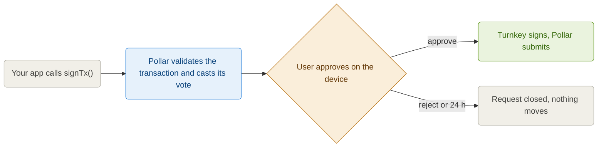

A **co-signed wallet** is a wallet nobody can use alone. Its key lives in a [Turnkey](https://www.turnkey.com) secure enclave inside a sub-organization that belongs to one end user, and every signature needs two votes: the user's device and Pollar. Pollar never holds the key and cannot move funds by itself; the user cannot be impersonated by a compromised Pollar server, because the device checks every transaction before it votes.

This is an opt-in custody mode for **new wallets on mainnet**. Testnet keeps the custodial model described in [Security Model](https://docs.pollar.xyz/docs/core-concepts/security-model), and wallets that already exist are never migrated.

---

## The model

Each end user gets a Turnkey sub-organization with two root users and a root quorum of 2:

| Root user | Credential | Who holds it |
| --------- | ---------- | ------------ |
| The end user | A P-256 key the SDK generates on the device (non-extractable WebCrypto on the web, the secure keystore on React Native) | Only the device |
| Pollar's approver | A P-256 API key per application (a primary and a standby) | Pollar's co-signing service |

The wallet inside the sub-org holds one account per chain the app enables: Stellar, Solana and Polygon addresses derived from the same seed. A chain enabled later is added the same way everything else happens on this wallet, as a request the user approves at their next sign-in. Signing is the only thing that needs both votes. Two policies let the user act alone on what is theirs:

| Policy | The user alone can | Pollar alone can |
| ------ | ------------------ | ---------------- |
| Credentials | Register or revoke a device on their own Turnkey user | Nothing: Pollar cannot add a key to the user, and the user cannot add a key to Pollar |
| Export | Export the wallet with Turnkey's `export_wallet` | Nothing |
| Signing | Nothing | Nothing: every signature is a 2-of-2 vote |



Pollar's vote is cast first, as the request that opens the activity. An approval has a 24 hour window; after that the request expires and the transaction is dropped.

A transaction built when the request opens would be stale by the time a user gets to it: a Solana blockhash lasts about a minute, a Stellar sequence or a sponsor's signature a few minutes. So the SDK asks Pollar to **rebuild the request right before the vote**. Pollar composes the transaction again, casts its vote on a fresh activity and retires the old one; the request keeps its id, and what the device verifies and approves is seconds old. Requests your app composed itself (an XDR you built and passed to `signTx`) are approved as they are.

---

## Turning it on

**Dashboard -> Treasury -> Account Funding -> Wallet custody**, on a mainnet application. Pick **Co-signed with Turnkey (2-of-2)**. The setting applies to wallets created after the change; users who already have a wallet keep it as it is.

Co-signed wallets need `@pollar/core` **0.11.5 or later**, because the device key is registered when the wallet is created. On an app in co-signed custody, a login or `createWallet()` from an older SDK that cannot send the key answers **409 `SDK_UPGRADE_REQUIRED`** for users who have no wallet yet. Existing users are not affected.

---

## What changes in the SDK

The wallet is created the same way as a custodial one; its Stellar account is funded by the first co-signed transaction, a sponsored `createAccount` the user approves once. Until then the wallet reports `provisioning: 'CREATING'`. The trustlines your app enables follow the same way, one request at a time, until the wallet holds every asset.

Every signing call can come back pending instead of signed:

```ts
const result = await pollar.signAndSubmitTx({ xdr });

if (result.status === 'cosign_pending') {
  // result.request is the CosignRequest waiting for the user's vote.
  // The transaction state is 'awaiting_cosign' until it resolves.
}
```

With `@pollar/react` nothing else is needed: the provider opens **`CosignModal`** when a request arrives. The modal recomputes the transaction hash from the unsigned payload, reads the activity straight from Turnkey through the relay and only enables **Approve** when both match. The transaction then continues on its own: a `sign` call resolves to the signed XDR, a `signAndSubmitTx` call submits and reports `success` or `error`.

To build your own UI, use the headless API:

| | What it does |
| - | ------------ |
| `useCosign()` | `pending`, `lastResolved`, `approve(request)`, `reject(request)`, `verify(request)`, `refresh()` |
| `pollar.cosign.pending()` | The requests waiting for this device |
| `pollar.cosign.verify(request)` | Compares what the request carries with what Turnkey was asked to sign, read straight from Turnkey: the Stellar transaction hash, the Solana serialized transaction, or the account derivation parameters. Never trusts the server's summary |
| `pollar.cosign.refresh(request)` | Asks Pollar to rebuild the request with fresh chain state; `approve` does this on its own |
| `pollar.cosign.approve(request)` | Refreshes, verifies, then stamps the approval with the device key. Throws `SDK_COSIGN_VERIFICATION_FAILED` and sends nothing if the payloads differ |
| `pollar.cosign.reject(request)` | The user's vote against it |
| `pollar.cosign.devices()` | The device keys enrolled for this user |
| `pollar.cosign.inspectQuorum()` | Reads the root quorum from Turnkey with the device key: two users, threshold 2 |
| `pollar.onCosignStateChange(cb)` | Fires on every pending or resolved request |

The same requests are reachable over HTTP: `GET /cosign/requests`, `GET /cosign/requests/:id?sync=1`, `POST /cosign/requests/:id/refresh`, `POST /cosign/requests/:id/cancel`, `POST /cosign/relay` and `GET /cosign/devices` on the v2 SDK API.

---

## Solana and Polygon

A Solana transfer from a co-signed wallet goes through the same `POST /v2/tx/build-sign-submit` as a custodial one and answers `202` with the request. Pollar compiles the transaction, Turnkey signs it once the user approves, and Pollar broadcasts it. When the token is marked **sponsor transfers** in the dashboard, the app's GAS wallet is the fee payer and signs last, exactly as it does for custodial wallets; otherwise the user pays the fee in SOL. Outcomes land in `/v2/tx/status` and the history as usual.

A Polygon account exists in every co-signed wallet that enables the chain, but the SDK API has no Polygon transfer path yet, co-signed or not.

---

## The device key

The device key is not the DPoP session key: it lives in its own namespace and survives logout, because losing it would mean losing the vote. A user who signs in on a second device registers that device's key on their own Turnkey user; Pollar relays the request but cannot alter it, since the stamp covers the body byte for byte.

A request the device sends to Turnkey outside the relay cannot complete either. Turnkey parks it waiting for Pollar's vote, and Pollar rejects every pending activity it did not open.

---

## Export and leaving Pollar

The user alone can export the wallet from Turnkey; Pollar is not part of that vote. The export bundle is encrypted to a key the user provides, so the seed is never visible to Pollar on its way out. This is the guarantee behind the model: if Pollar disappears, the funds do not.

---

## What Pollar still does

Turnkey signs a Stellar transaction as raw bytes and cannot read it, so the checks that protect the user run in Pollar before its vote: the transaction policy of your app, the destination allowlist, fee ceilings and the operation whitelist. A transaction that fails them is refused before any activity is opened. The user's device verifies the hash of what Pollar submitted, not the policy; the two votes cover different risks.
